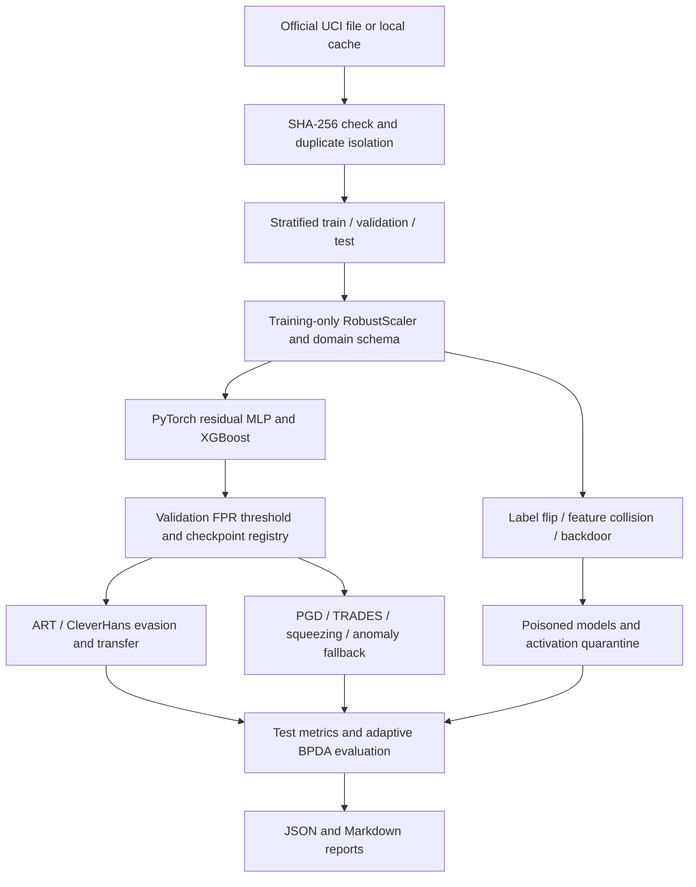

# ml-adversarial-security

An entirely local Python experiment system for evasion, training-data poisoning, and defensive evaluation of email spam classifiers. It trains a residual PyTorch MLP and XGBoost on authentic public Spambase records. ART and CleverHans execute real attacks; reports contain measured outputs. There are no hosted inference calls, API keys, synthetic replacement datasets, or mocked tests.

This is a feature-space research harness. A valid vector is **not proof that a corresponding email can be constructed**. It does not modify live mail systems, reconstruct messages, or establish deployment readiness. The dataset is historical; results do not establish performance on present-day spam, malware, or network intrusion traffic.

## Setup and reproducible execution

**Model lab** adds three tools to the dashboard:

- **Combine filters:** select 2–8 actual trained models, fit nonnegative weights that sum to one (or choose equal shares), choose a decision threshold, measure test performance, and replay a saved attack through the combined model. Member comparisons use the same threshold-selection records and false-alarm target. Download the real weights, threshold, checkpoint references, source-row split, test scores, and attack scores.
- **Calibrate confidence:** fit a sigmoid correction or a monotone fitted curve to one model's scores. Compare test score error, log loss, decision results, and observed spam frequency in 5, 10, or 20 confidence bands. Inspect the records in any populated band and export the fitted coefficients or curve knots. The monotone curve uses linear interpolation with clipped end values.
- **Remove measurements:** choose 1–12 measurements and replace them with training-derived medians or zero in original units. Rerun each field separately and cumulative groups, count new/fixed mistakes, inspect exact replacement values and individual source records, and export any selected trial. Integer measurement medians are rounded to integer values. Locked attack fields remain available for this input-availability diagnostic.

Ensemble weights and confidence corrections fit on one deterministic half of validation records; thresholds use the separate half, with both classes represented in each. Test labels do not fit parameters. The exact source IDs and fitted parameters are exported in the recipe. A false-alarm target constrains the threshold-selection records, not future or held-out error rates. Improvements are not guaranteed. Saved attacks are fixed examples, and missing-input trials are diagnostics rather than newly optimized attacks. These tools leave the original model checkpoints and reports intact.

**Attack tests → Replay and compare saved attacks** runs every trained filter on a saved attack batch, including changed-data and cleaned models. It reports each filter's initially caught records, actual escapes, after-attack catches, newly caught records, and score movement. These are fresh model predictions on fixed saved examples; the tool does not optimize a new attack against each model.

Choose another attack or another run to compare outcomes on shared source rows. Filter for records caught only in either result, caught/missed in both, or changed decisions. Different attack subsets are never paired by position; unmatched rows are counted separately. Each run uses its own verified model, training scale, and decision threshold. **Compare measurements** opens all 57 reconstructed source-unit measurements for both attacks, including changes and locked fields. Export the full filter replay, every matching record, or one record's complete measurement changes. Cross-run differences can reflect training, scaling, thresholds, and attack settings together.

The dashboard now supports **reusable experiment settings**: save the current form or capture a verified report configuration, retain numbered revisions and notes, apply settings to experiments or campaigns, export a revision, and archive/restore presets. Any historical revision can start a fresh complete pipeline. Saves reject outdated revisions; reuse checks that fixed data and execution settings still match. The library is stored in `runs/dashboard-presets.sqlite3`.

**Repeat configuration** in process history works for completed, failed, and stopped processes. Review the original settings, run them again in a new directory, or load them for correction. **Repeat selected run** uses the verified report configuration. Launches check the configuration again, train real models, and record their source preset/revision, process, or report.

**Retry unsuccessful runs** creates a separate campaign containing only failed, stopped, or interrupted entries that actually started. Correct a shared setting while preserving original seeds and the varied setting. Completed runs and entries that never started remain in the original campaign. Both histories and all earlier reports are retained.

### Local dashboard

```powershell
Set-Location to your partition'
.\.venv\Scripts\ml-adv-sec.exe dashboard
```

Open [Filter Lab](http://127.0.0.1:8873). The dashboard reads your saved results, compares filters and attacks, shows the effects of changed training data, and exports the selected report. Use **Inspect** beside an attack to browse the actual email records, compare all 57 measurements, and calculate before-and-after scores from the saved model weights.

**Run experiments** starts the complete local pipeline with settings you can edit: training rounds, attack steps and restarts, data size, model width, change limits, cleanup trials and more. Settings initially come from the selected CLI configuration. Runs have their own folders and keep their real process output and exit status. A failed or stopped run never receives a completed report. Only one dashboard-started run executes at a time. There are no sample charts or made-up results when reports are missing.

The server listens on this computer only. It does not download data or call outside services. Download the dataset using the preparation command below before starting an experiment. Close the server with Ctrl+C when running it in a terminal. Use `dashboard --port 8890` if the default port is occupied. Configuration, process history and logs for dashboard-started runs are stored under `runs/dashboard-jobs/`; their results are stored in separate `runs/experiment-*/` folders. The original reports remain available.

The supplied workspace already has a working local environment. To run it immediately on this machine:

```powershell
Set-Location 'your partition here'
.\.venv\Scripts\ml-adv-sec.exe verify-all
.\.venv\Scripts\python.exe -m pytest
```

Use Python 3.11 or 3.12 in a virtual environment. Run commands from this repository's directory. The tested environment is recorded in `requirements-lock.txt` (Python 3.11, Windows, CPU). The dependency ranges in `pyproject.toml` support normal installation; use the lock snapshot to reproduce the tested package versions. Other platforms require verification on their own hardware.

```powershell
py -3.11 -m venv .venv
.\.venv\Scripts\Activate.ps1
python -m pip install -r requirements-lock.txt
pip install -e .
```

On Linux/macOS, create the environment with `python3.11 -m venv .venv` and activate it with `source .venv/bin/activate`; the remaining Python commands are identical. If PowerShell activation is restricted, invoke `.\.venv\Scripts\python.exe` and `.\.venv\Scripts\ml-adv-sec.exe` directly.

This machine has no globally registered Python. Its local Python 3.11.9 runtime is `D:\PROIECTE\.runtimes\python311\tools\python.exe`; use that executable instead of `py -3.11` when recreating this workspace's environment. The runtime was obtained from the Python distribution on NuGet. Neither the runtime nor the environment is part of the portable source package.

Download from the official UCI file endpoint once, then operate offline:

```powershell
ml-adv-sec prepare --download
ml-adv-sec train
ml-adv-sec attack-evasion
ml-adv-sec attack-poison
ml-adv-sec defend
ml-adv-sec evaluate
pytest
ml-adv-sec verify-all
```

The single-command equivalent, including an initial download if necessary:

```powershell
ml-adv-sec verify-all --download
```

`python -m ml_adv_sec` is equivalent to `ml-adv-sec`. Each stage checks the prepared-data manifest before doing work. `evaluate` requires the preceding training, evasion, poisoning, and defense artifacts. `defend` requires the poisoning stage. Missing artifacts fail explicitly.

For a shorter, fully real-data execution check:

```powershell
python -m ml_adv_sec --config configs/quick.yaml verify-all --download
```

The quick configuration uses a stratified subset of 640 actual records and deliberately short optimization. It exercises every attack, poison ratio, defense, and report path. It is not evidence that models or attacks have converged. `pytest` independently trains and attacks that real subset in temporary directories. Tests fail with an actionable error if `data/spambase.data` is missing; they never silently skip or substitute data.

Offline preparation: copy the authentic `spambase.data` into `data/spambase.data` and run `ml-adv-sec prepare` without `--download`. A different byte representation is rejected even if its numbers appear equivalent. Only `prepare --download` and `verify-all --download` enable dataset network access. Package installation initially needs a package index or a prepopulated local wheel cache. ART initializes its standard `.art` configuration/cache under the user profile.

## Data and partitioning

Source: [UCI Spambase](https://archive.ics.uci.edu/dataset/94/spambase), DOI [10.24432/C53G6X](https://doi.org/10.24432/C53G6X), CC BY 4.0. The authors are Mark Hopkins, Erik Reeber, George Forman, and Jaap Suermondt. The dataset contains 4,601 email records, 57 numeric features and a binary label (spam = 1). Features are 48 word frequencies, six character frequencies, and three capital-run statistics. The package uses the [official unmodified data file](https://archive.ics.uci.edu/ml/machine-learning-databases/spambase/spambase.data).

Pinned SHA-256 of that file:

```text
b1ef93de71f97714d3d7d4f58fc9f718da7bbc8ac8a150eff2778616a8097b12
```

The pin establishes consistency with the retrieved release bytes, not a separately signed publisher attestation. Downloads are checked before replacing the cache. Existing cached files are checked on every preparation.

Exact feature duplicates are collapsed. Groups sharing identical features but conflicting labels are discarded. The remaining unique records are stratified into 60% train, 20% validation, and 20% test using the configured seed. The optional quick subset is selected with stratification before partitioning. Raw row indices remain in the saved splits. RobustScaler center/IQR and feature minima, maxima, integer and binary observations are fitted exclusively on training records. Immutable fields are a configurable threat-model choice; the default freezes all three capital-run features.

Spambase has no timestamps, host identifiers, campaign identifiers, or malware-family annotations. Temporal, host-level, or campaign-level isolation cannot be verified with this dataset. The implementation guarantees exact-feature duplicate isolation, not the absence of every kind of real-world correlation. Reported semantic subgroups are spam containing the word `free` versus other spam; these are not claimed to be attack families.

`prepared/manifest.json` hashes the raw source, processed splits, fitted scaler and schema. It also records the configuration and partition sizes. Changing the configuration requires preparation in a separate run root, or a deliberate new preparation. Absolute manifest paths bind a run to its location: prepare again after moving it. SHA-256 detects changes relative to the local manifest; it is not protection against an adversary who can rewrite both manifest and data.

## Architecture and persisted outputs



Source layout:

```text
src/ml_adv_sec/
  data/        official loader, split hashes, training schema, constraint projector
  models/      residual MLP, XGBoost, threshold calibration, versioned registry
  attacks/     evasion, BPDA, label flips, ART feature collisions, backdoor
  defenses/    activation filtering, quantization, gradient and OOD detector
  eval/        inference metrics, experiment stages, Pareto and report generation
  cli.py       prepare / train / attack-evasion / attack-poison / defend / evaluate / verify-all
```

Default model/data artifacts go into `runs/default/`. Each checkpoint has versioned `.pt` or `.joblib` weights, SHA-256, configuration, dataset hashes, validation metrics, source-file hashes, package versions, and the available enclosing Git commit. In a new or uncommitted checkout, the Git revision may be absent or predate this source; source hashes identify the actual files. `latest.json` points to a version; old weights remain available. Attack and poison `.npz` files have companion hash manifests. Quarantine artifacts retain both training positions and original source row IDs. Only load model/scaler files from trusted local runs: joblib deserialization executes Python objects.

The default report files are `reports/benchmark_results.json` and `reports/benchmark_results.md`. Quick reports are under `runs/quick/reports/`. The JSON retains the full experiment configuration, environment, data provenance, validation thresholds, constraints, attack query counts, poisoning differences, and detector outcomes. Reports are generated from arrays and predictions, never prefilled benchmark constants.

## Threat model and optimization

The defender predicts spam when `p(spam | x) >= threshold`. White-box attackers know the MLP and scaler and can change mutable feature values. The transfer attacker attacks that surrogate and evaluates the same vectors against XGBoost without its gradients. HopSkipJump receives only thresholded decisions; its queried-record count is recorded. Training-time attackers can alter a configured fraction of actual training records. Validation and test labels stay clean.

Let `z = (x - center) / scale` be the RobustScaler representation. Epsilon is measured in these transformed units, **not raw percentages**. All reported perturbation norms refer to z. For a label y and loss L:

* FGSM: `z_adv = P(z + epsilon * sign(gradient_z L))`. Both ART and CleverHans implementations execute.
* PGD: `z_(t+1) = P(z_t + alpha * direction(gradient_z L))`, with ART L-infinity or L2 projection, configured random restarts and step-size fractions. The retained projected candidate maximizes per-record classification loss across step sizes.
* C&W L2: ART minimizes a perturbation-distance/classification-margin objective using finite optimization and binary search. It is not epsilon constrained; projected successful L2 distances are saved in JSON. These are empirical distances found by an optimizer, **not exact or certified minimum distances to the decision boundary**. Failed or already-misclassified points must not be interpreted as certificates.
* HopSkipJump: ART performs decision-only boundary search, then the returned candidate is projected onto the configured budget and schema. Final projection can destroy attack success; reports always evaluate the projected candidate. SquareAttack is not used because its image assumptions do not match tabular inputs.

For operational thresholds, the attack wrapper subtracts `log(threshold / (1 - threshold))` from the spam logit, aligning attack class decisions with the calibrated decision boundary. A reject-all threshold is represented by a very large offset. Attack success is computed with the original model and actual threshold.

`P` clamps to training feature ranges, rounds inferred integer dimensions in raw units, and restores immutable dimensions. Values outside training ranges in an original held-out record are allowed as anchors, so an unchanged real record stays feasible. Rounding that exceeds an L-infinity budget restores that coordinate; if a rounded L2 candidate exceeds its radius, the original record is retained. This conservative feasibility procedure is not an exact Euclidean projection onto a discrete constraint set. Raw versus final validity rates are recorded. Domain projection guarantees the implemented feature schema and budget, not raw-message realizability or consistency of all correlated frequencies.

## Poisoning and defenses

Poisoning ratios are fractions of the entire training partition. `max(1, floor(ratio * n_train))` distinct spam records are selected deterministically. Both requested and realized ratios are recorded. The default runs 1%, 3%, 5% and 10% for each method:

* Label flip changes selected spam labels to benign without changing vectors.
* Clean-label collision invokes ART FeatureCollisionAttack on selected spam vectors toward the representation of an actual benign training record. It preserves the original spam labels and applies the domain/epsilon projector. This measures the requested malicious-to-benign representation collision; it does not assume the attack improves evasion. It differs in direction from classic poison-frogs attacks that insert benign-label bases around a malicious target.
* Backdoor adds a fixed positive `epsilon / 2` offset to the first two mutable continuous features, projects them within the configured L-infinity budget, and changes selected training labels to benign. Test-time activation applies the identical additive pattern to held-out spam. This is a small feature-space trigger; its effectiveness is measured rather than assumed, and a small transformed change does not establish subtlety in an actual message. Trigger success is compared with the clean model under the same trigger.

PGD adversarial training mixes clean and on-the-fly constrained adversarial BCE losses equally. The TRADES-style mode optimizes `BCE(clean, y) + 3 * KL(p(clean) || p(adversarial))`. Its inner loop maximizes KL, using a CE first step to leave the zero-gradient clean initialization. It is a local tabular adaptation, not an exact reproduction of a paper's training setup. Both use the same real training partition and validation-only threshold selection.

The MLP uses a linear/BatchNorm/ReLU embedding, residual block, dropout, and a binary output trained with BCEWithLogitsLoss. ART sees equivalent two-class logits `[0, spam_logit]`. XGBoost trains 80 histogram trees on the identical transformed records.

Feature squeezing rounds transformed inputs to multiples of `quantum` and clamps them to training bounds. The adaptive evaluator uses the exact squeeze/clamp forward calculation with an identity backward approximation (STE/BPDA), then performs domain-constrained PGD on inputs. This explicitly tests through the nondifferentiable defense rather than treating zero quantization gradients as robustness. Finite attacks cannot prove robustness.

ART ActivationDefence performs PCA and per-class KMeans activation clustering on each poisoned model. The smaller cluster is quarantined and a fresh model is trained on retained records. Cluster sizes are a heuristic: false quarantines and detected poisoned counts are measured against known injected indices; they are not assumed to be correct.

The inference detector fits Ledoit-Wolf covariance and the 99th-percentile Mahalanobis/gradient-norm cutoffs on clean training records. Inputs exceeding either cutoff are flagged. The conservative fallback labels flagged records spam. Reports measure the resulting false positives and false negatives. The fallback is not calibrated to preserve the original FPR limit, and the detector itself is not adaptively attacked by the current BPDA experiment.

## Calibration, metrics, and report schema

Threshold calibration enumerates benign validation score boundaries, including tied-score successors, choosing the lowest threshold whose empirical validation FPR is at most `fpr` (default 1%; set 0.001 for 0.1%). It never uses test labels to choose a threshold. The guarantee is empirical on validation only: limited sample counts and distribution shift mean test FPR may exceed the target. Reject-all thresholds and ASR with zero eligible records are represented honestly; an undefined ASR is JSON `null` / Markdown `n/a`.

Accuracy = correct / all. F1 is the harmonic mean of spam precision and recall. ROC-AUC is the area under the ROC curve. The `pr_auc` field uses sklearn average precision (a non-interpolated precision-recall summary). FPR = FP / benign; FNR = FN / spam; Brier is mean squared probability error. Adversarial recall is detected spam / all attacked spam. Conditional evasion ASR = successfully evaded / spam originally detected by the evaluated target. The eligibility count is always saved.

Poisoning comparisons measure test FNR and Brier changes, score shifts and decision disagreement relative to the clean model; they also retain semantic subgroup FNR and trigger success. Decision disagreement on held-out observations is an empirical decision-change measure, not the volume between mathematical decision surfaces.

Per-record p50/p95 latency is measured with wall-clock timings after warmup on up to 128 actual test records. It includes squeezing where applicable. It depends on hardware and current load. Seeds fix Python, NumPy and Torch random streams; deterministic Torch operations are required and CPU thread count is configured. Predictions and splits are reproducible within the tested environment; latency and byte-level artifacts across library/platform changes are not guaranteed identical.

The default epsilon sweep is `{0.01, 0.03, 0.05, 0.1, 0.2}` for clean, PGD-trained, TRADES-trained and adaptively attacked squeezing variants. It records every point and marks points not dominated simultaneously in clean F1, adversarial recall and p95 latency. The sweep attacks the first configured number of spam records in the seeded test partition; it is a bounded evaluation subset, not an estimate over all possible adversarial inputs.

Generate the actual tables with:

```powershell
ml-adv-sec verify-all
# Or regenerate after all prior stages:
ml-adv-sec evaluate
```

The generated table schemas are:

```text
Clean utility:
model | n | accuracy | roc_auc | pr_auc | f1 | fpr | fnr | p50_ms | p95_ms

Evasion and transfer:
source | target | attack | attack_n | eligible | adversarial_recall | asr | raw_valid_fraction | projected_valid_fraction

Robustness and utility sweep:
model | epsilon | clean_f1 | adversarial_recall | asr | p95_ms | pareto

Poisoned and sanitized:
model | f1 | fpr | fnr | fnr_delta | brier_delta | decision_disagreement | trigger_asr
```

No benchmark performance values are embedded in this README. Run evidence and limitations are recorded in `VERIFICATION.md`; measured tables belong in the generated reports.

## Explore the results locally

Open `http://127.0.0.1:8873` while the dashboard is running.

- **Record explorer:** select any original, hardened, changed-data, or cleaned model. Find missed spam and regular email flagged by mistake; filter by actual label and decision, search the original source row, sort scores, and page through every held-out record. Counts always cover the full test set. **Recalculate scores** restores the run's pinned model and checks every saved score against a fresh prediction. CSV exports contain every matching row, the decision threshold, and report hash; original measurements are optional.
- **Compare runs:** place two measured runs side by side. Compare spam caught, false alarms, F1, and attack escape rates. The view checks original source IDs separately for the complete test set and attacked subset, so equal test-set sizes cannot hide different records. Attack limits and eligible counts remain visible. Export paired model measurements and processing times as CSV.
- **Training changes → Inspect records:** inspect the actual selected, changed, removed, or complete training records for every change type and share. Open a record to see its original and changed labels, all changed measurements, locked fields, and four fresh scores: original and changed inputs through both the original and selected models. Removal marks identify the matching cleanup trial; the view explains whether the selected model was trained before or after cleanup.

Every analysis request verifies the saved evidence. Open views carry the report hash and reject an updated report rather than mixing results from different versions. The original dataset contains numeric measurements, not the email message text.

### Decision lab and record-level comparisons

**Decision lab** recalculates validation and test scores from the selected run's pinned model. Keep the saved decision rule, enter a score threshold, or choose a false-alarm target calibrated on validation records only. The preview shows actual confusion counts for both partitions, changes versus the saved decisions, score-band counts and observed spam shares, up to 101 measured validation boundaries, and changed test records. **Preview flag none** measures the extreme where no email is flagged. CSV export includes every validation/test record, both thresholds, both decisions, scores, source IDs, and the report hash. Previews do not modify checkpoints or saved results. Test results help assess consequences; they should not be used to tune a rule and then claimed as an independent evaluation of that rule.

**Filter disagreements** compares two filters within a run or across saved runs. Both sides can use original, hardened, changed-data, or cleaned models. Matching requires identical source-data bytes and intersects actual held-out source IDs; records outside the intersection are counted explicitly and never treated as paired observations. Review different decisions, records only one side gets right, shared mistakes, or the entire intersection. Pagination and CSV export use the complete selected category. Each side's threshold and report fingerprint are included in the export.

**Inspect record** is available from the explorer, changed-decision list, and either side of the disagreement view. It recalculates the five original/hardened models plus the selected training-change model when applicable, checks their complete test-score vectors against the saved evidence, and displays that record's actual scores and decisions. It also shows all 57 exact original source measurements, scaled dataset values, and locked-field rules. In a cross-run comparison, the inspector identifies which run supplied the model weights and scaler.

### Input importance and attack overlap

**Input importance** runs repeatable column-shuffle checks for any original, hardened, changed-data, or cleaned model. Choose held-out test or validation records, one to ten repeats, and a seed. For each of the 57 measurements, the model runs on a copy with that column reassigned among actual records. The view reports changes in squared prediction error, accuracy, spam caught, false alarms, mean score movement, and decision counts. Sort by any measured quantity and inspect every repeat. Spread is the sample standard deviation across repeats, not a confidence interval; one repeat cannot estimate variability. CSV export repeats the exact seeded calculation and includes individual trials, model, partition, threshold, and report hash.

Shuffling uses observed values but breaks their relationships with other measurements. This is a model-dependence diagnostic, not a causal explanation or a feasible attack. Fields locked during attacks remain eligible for this diagnostic. Constant columns and negative importance values are kept rather than replaced with invented positive rankings.

**Attack overlap** recalculates before/after scores for all six saved attack variants against the original or tree filter. It verifies original measurements and source IDs, intersects actual attacked record sets, and compares outcomes only on that shared cohort. The matrix shows the number escaping both attacks and that count divided by the number escaping either. The share is undefined when neither attack has escapes. Originally missed spam never counts as an attack escape or resistance success. Filter records escaping any attack, exactly one, or none while originally caught; page through every matched record and open each exact saved attack from its score. The CSV includes every matching source-record/attack pair and its actual score and threshold. Different attack settings prevent interpreting overlap as an equal-strength ranking.

The attack table and inspector use the same full inference batch shapes as the saved evaluation. This avoids tiny batch-dependent rounding differences and checks complete score vectors before presenting an inspected record.

### Error breakdowns and data differences

**Error breakdowns** recalculates held-out scores for any original, hardened, changed-data, or cleaned model and groups the actual outcomes by a selected source measurement. Request 4, 5, or 10 bands; boundaries use training quantiles only, with tied/minimum/maximum cuts removed rather than forcing invented groups. Each band shows training/test counts, missed spam, false alarms, and rates with their actual denominators. Empty or single-class groups keep undefined rates empty. Select a band, filter mistakes or correct decisions, page through source records, and open the existing fresh-score inspector. Export all band results or every matching record. Record filters do not change the full-test band totals, and the saved model threshold remains unchanged.

**Data differences** compares the authentic training measurements with either test or validation records, using all email or the same selected label on both sides. All 57 measurements receive descriptive statistics, the largest empirical cumulative-share gap (two-sample KS statistic), raw one-dimensional Wasserstein distance, training-scaled distance, zero-share change, and counts outside the training range. Scaling uses training IQR and falls back to training standard deviation; truly constant training values have no scaled distance. No significance claims or p-value ranking are presented. Source units vary, so raw distances across different measurements are not directly comparable.

Inspect any measurement to see training-derived value bands with explicit below/above-range groups, exact source-record values, and an outside-range filter. Constant fields have a clearly labeled exact-value band. Summary CSV includes all 57 measured comparisons; record CSV includes every matching row and all 57 original source values. These are comparisons between corpus partitions, not evidence of time-based change or future model performance. Both views are exploratory analyses of existing held-out records, not new independent benchmarks.

### Capability upgrade: controlled experiment campaigns

On **Run experiments**, set up the actual training/attack configuration and choose **Build campaign from these settings**. The campaign runner can repeat it across distinct seeds or cross those seeds with values for allowed attack change, attack steps, training rounds, learning rate, model width, or input rounding. A plan can contain up to 12 real runs. All editable settings are validated and frozen before anything starts; fixed dataset/run context is checked again before queued entries launch.

Each entry executes the complete existing `verify-all` pipeline in its own run directory. This is a sequential process queue, not a replay of saved answers. It waits for an existing manual experiment, records ownership in each process record, and exposes actual output and exit codes. Pause lets the current run finish. Cancel affects only that campaign's owned active process and queued entries. A failure can stop the queue. Continuing resumes pending entries and never automatically retries failed or interrupted ones.

The queue is saved under `runs/dashboard-campaigns`. Paused campaigns survive server restart without repeating completed entries. Lost process tracking is marked interrupted rather than treated as success; resuming continues only the still-queued entries. Closing the dashboard server may stop its active process, so pause after the current run before an intentional restart. Result comparisons require actual successful process completion and the exact report fingerprint saved by that process. Changed or invalid reports are excluded explicitly.

Comparisons show run-level means, sample standard deviation, and ranges for utility measurements, plus attack escape rates and after-attack spam recall grouped by the varied setting. Undefined escape rates are counted and excluded from escape-rate means; a single defined run has no estimated spread. Different seeds can change the test partition, so these are replicate summaries rather than paired-record causal effects or pooled confusion counts. Separate utility/attack CSVs include each underlying measured row and report fingerprint.

### Case notebook and exact attack-budget inspection

**Save record to notebook** in the source-record inspector binds a local case to that actual held-out source row, selected model, and exact report fingerprint. You can also create a case manually from the selected run. Saving first verifies membership and recalculates pinned-model scores. Titles, notes, tags, and status are user-authored metadata; the app does not generate investigation conclusions. SQLite storage is `runs/dashboard-notebook.sqlite3`. Updates use checked revisions and transactions, so stale concurrent edits cannot silently replace newer notes. Archive preserves history. Unsaved editor drafts remain available in the current tab's memory while that app session remains open.

Opening or exporting a case rechecks source/report/checkpoint evidence and recalculates model scores. If a report was changed or removed, notes and history remain available while the model results are explicitly unavailable; the case is not silently rebound to newer results. Export the matching note list as CSV or one saved case, revision history, and freshly checked evidence as JSON. Spreadsheet exports keep formula-looking note text as text. This is a local revision history, not a signed or tamper-proof audit log.

**Attack budgets** reloads the actual saved sweep inputs for original, attack-trained, stability-trained, or rounded-input models. Every measured level is rerun through its pinned model and checked against the saved escape counts/rates. It retains non-monotonic outcomes, distinguishes already-missed spam, and shows the first observed successful level without claiming an exact minimum or certified robustness. Open any score for original-unit before/after measurements, actual scaled input distances, and locked-field changes. Export all budget summaries or every matching record/level outcome; no missing levels are interpolated or invented.

## Verification coverage

The real-data pytest suite verifies authentic source bytes, split isolation, training-only scaling, deterministic splits/predictions, tamper detection, checkpoint round trips, all six attack/norm variants, integer/immutable preservation, perturbation bounds, actual poisoning changes, clean-label preservation, both robust training modes, ART sanitization, detector fallback, BPDA execution, and full report generation. No test patches library behavior, uses dummy models, or substitutes synthetic samples. Use the full default run to study behavior and tune attack budgets; passing tests establishes execution and checked invariants, not security efficacy.

Implementation references: [ART evasion APIs](https://adversarial-robustness-toolbox.readthedocs.io/en/latest/modules/attacks/evasion.html), [ART poisoning APIs](https://adversarial-robustness-toolbox.readthedocs.io/en/latest/modules/attacks/poisoning.html), [ART activation defenses](https://adversarial-robustness-toolbox.readthedocs.io/en/latest/modules/defences/detector_poisoning.html), [CleverHans source](https://github.com/cleverhans-lab/cleverhans).
